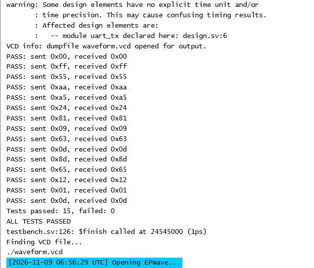
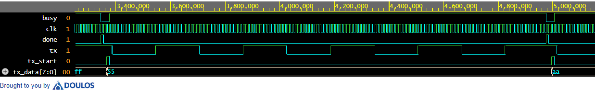
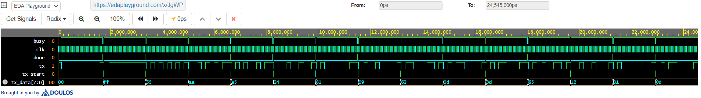

# UART Transmitter using Verilog HDL

## Overview

This project implements an 8-bit UART (Universal Asynchronous Receiver Transmitter) Transmitter in Verilog HDL. The design uses a Finite State Machine (FSM) to control serial data transmission and includes a custom Verilog testbench for functional verification through simulation.

The transmitter follows the standard UART frame format consisting of:
- 1 Start Bit
- 8 Data Bits (LSB First)
- 1 Stop Bit

---

## Features

- Verilog HDL implementation
- FSM-based control logic
- 8-bit serial data transmission
- Configurable baud rate using a parameter
- Shift-register based serialization
- Busy and Done status signals
- Custom Verilog testbench
- Simulation waveform verification
- Logic synthesis using Yosys (gate-level netlist and area report)
- Post-synthesis (gate-level) simulation using the same testbench

---

## Project Structure

```
UART-Transmitter/
│── uart_tx.v             // UART Transmitter RTL
│── uart_tx_tb.v          // Testbench
│── uart_tx_synth_16.v    // Yosys synthesized gate-level netlist (CLKS_PER_BIT = 16)
│── synth_report_16.txt   // Yosys synthesis log and statistics
│── README.md
│── images/
│     ├── waveform_0x55.png
│     ├── waveform_full.png
│     ├── post_synth_console.png
│     ├── post_synth_waveform_0x55.png
│     └── post_synth_waveform_full.png
```

---

## Finite State Machine (FSM)

The UART transmitter operates using four states:

```
        +------+
        | IDLE |
        +------+
            |
            | tx_start
            v
        +-------+
        | START |
        +-------+
            |
            v
        +------+
        | DATA |
        +------+
            |
            v
        +------+
        | STOP |
        +------+
            |
            +------------+
                         |
                         v
                      IDLE
```

---

## Inputs

| Signal | Description |
|--------|-------------|
| `clk` | System Clock |
| `reset` | Asynchronous Reset |
| `tx_start` | Starts a transmission |
| `tx_data[7:0]` | 8-bit input data |

---

## Outputs

| Signal | Description |
|--------|-------------|
| `tx` | Serial UART output |
| `busy` | High while transmission is in progress |
| `done` | Pulses high when transmission completes |

---

## Simulation

The design was verified using a self-checking Verilog testbench (`uart_tx_tb.v`).

The testbench uses a small `CLKS_PER_BIT` (16) for fast simulation, and includes:

- A `send_byte` task that drives `tx_start` and `tx_data`
- A `receive_and_check` task that samples the `tx` line at the middle of each bit (LSB first), reconstructs the byte and compares it with the expected value, also checking the stop bit
- A pass/fail counter with a final summary

Test data:

- Directed bytes: 0x00, 0xFF, 0x55, 0xAA, 0xA5
- 10 random bytes (`$random`)

The simulation verified:

- Correct start bit generation
- LSB-first serial transmission
- Correct stop bit generation
- Proper FSM state transitions
- Busy and Done signal operation

Results are reported as `PASS`/`FAIL` per byte, followed by `ALL TESTS PASSED` when no failures occur.

---

## Waveform

### Single Frame (0x55)


Transmission of byte `0x55`. The `tx` line goes low for the start bit, sends the 8 data bits LSB first (1,0,1,0,1,0,1,0), then returns high for the stop bit. `busy` stays high for the whole frame, `done` pulses once at the end, and `state` moves through START (1) → DATA (2) → STOP (3) → IDLE (0).


### Full Simulation


Full testbench run: 15 bytes transmitted (0x00, 0xFF, 0x55, 0xAA, 0xA5 and 10 random values), all passing. `busy` stays high for each frame, `done` pulses once per byte, and `state` cycles through START → DATA → STOP → IDLE for every transmission.

---

## Synthesis (Yosys)

The design was synthesized using the open-source **Yosys** synthesis tool (v0.52, run on Ubuntu via WSL) to convert the RTL into a generic gate-level netlist.

The `CLKS_PER_BIT` parameter is set to 16 during synthesis (`chparam`), so the netlist matches the configuration used in the testbench.

### Command

```
yosys -p "read_verilog uart_tx.v; chparam -set CLKS_PER_BIT 16 uart_tx; synth -top uart_tx; stat; write_verilog uart_tx_synth_16.v" | tee synth_report_16.txt
```

### Output Files

| File | Description |
|------|-------------|
| `uart_tx_synth_16.v` | Synthesized gate-level netlist |
| `synth_report_16.txt` | Full Yosys log with the `stat` summary |

### Synthesis Results

| Metric | Value |
|--------|-------|
| Number of ports | 7 |
| Number of port bits | 14 |
| Number of public wire bits | 45 |
| Total cells | 174 |
| Flip-flops | 34 |
| Combinational gates | 140 |
| Memories | 0 |

### Cell Breakdown

| Cell Type | Count |
|-----------|-------|
| `$_ANDNOT_` | 42 |
| `$_OR_` | 39 |
| `$_XOR_` | 15 |
| `$_DFF_PP0_` | 20 |
| `$_DFFE_PP0P_` | 12 |
| `$_MUX_` | 11 |
| `$_NAND_` | 9 |
| `$_ORNOT_` | 9 |
| `$_NOR_` | 7 |
| `$_AND_` | 4 |
| `$_DFF_PP1_` | 2 |
| `$_NOT_` | 2 |
| `$_XNOR_` | 2 |

The design has 32 register bits (2-bit state, 8-bit shift register, 3-bit bit index, 16-bit baud counter, and the `tx`, `busy` and `done` outputs). Yosys reports 34 flip-flops because it re-encoded the 2-bit FSM state as one-hot (4 flip-flops). The remaining cells are combinational logic. The testbench is excluded from synthesis since it is not synthesizable.

---

## Post-Synthesis Simulation

To confirm that synthesis preserved the design's functionality, the same self-checking testbench was run on the synthesized gate-level netlist (`uart_tx_synth_16.v`) instead of the RTL.

- **Simulator:** Icarus Verilog (EDA Playground)
- **Design under test:** `uart_tx_synth_16.v`
- **Testbench:** `uart_tx_tb.v`, unchanged except that the `#(.CLKS_PER_BIT(16))` parameter override was removed, since the netlist has no parameters (the value is already fixed at 16 during synthesis)
- **Type:** zero-delay gate-level simulation (no timing annotation)

**Result:** all 15 bytes (5 directed + 10 random) passed, matching the RTL simulation.

### Console Output



### Single Frame (0x55)



Gate-level waveform for byte `0x55`: start bit, 8 data bits LSB first, then the stop bit. The behavior is identical to the RTL simulation.

### Full Simulation



Gate-level simulation of all 15 bytes, with `done` pulsing once per byte.

> Internal signals such as `state` are not shown, because Yosys re-encodes the FSM and renames internal wires in the netlist. Only the top-level ports are compared.

---

## Tools Used

- Verilog HDL
- EDA Playground
- Icarus Verilog
- EPWave
- Yosys (logic synthesis)

---

## Future Improvements

- UART Receiver implementation
- Parity bit support
- Configurable stop bits
- Parameterized data width
- SystemVerilog-based verification
- Timing and area analysis for a target FPGA/ASIC flow

---

## Author

**Aatif Junaid**
